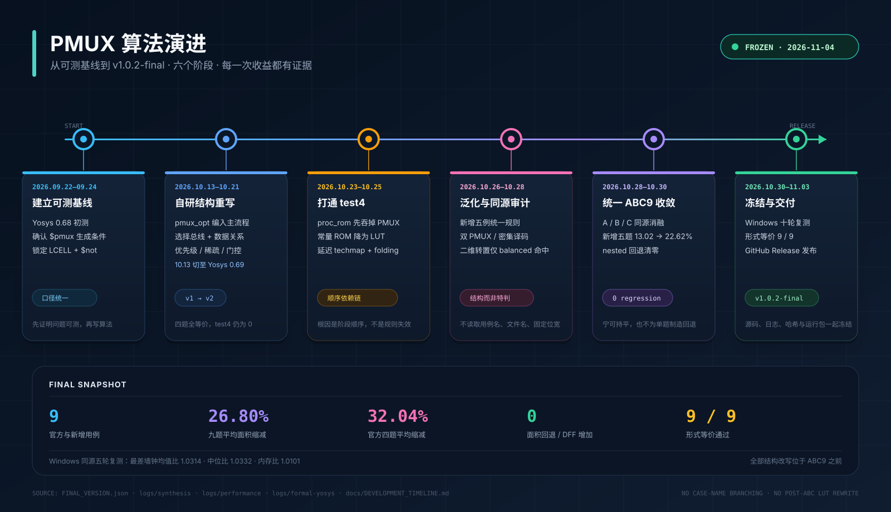

# PMUX-2026-Final

2026 年 FPGA 竞赛选题二的冻结复现仓库。项目在 Yosys
`synth_intel -family cycloneiv` 流程中加入 PMUX 结构识别与重写，在保持
逻辑等价、DFF 数量不增加和不使用 legacy ABC 的前提下降低
`cycloneiv_lcell_comb + $not` 面积。

## 算法演进



从官方基线、自研 PMUX 重写、`test4` 根因定位，到统一 ABC9、
形式验证与 Windows 冻结交付的六个阶段，以及关键纠错和 A/B/C 消融，
见 [`docs/DEVELOPMENT_TIMELINE.md`](docs/DEVELOPMENT_TIMELINE.md)。

时间线依据真实工作日志和冻结证据整理；Git 发布树没有补造历史提交。

## 结果

以下是最终冻结的 Windows 测量结果。面积口径为
`cycloneiv_lcell_comb + $not`；DFF 为 `dffeas`。

| 用例 | 基线 LCELL | 基线 `$not` | 基线总计 | 候选 LCELL | 候选 `$not` | 候选总计 | 缩减 | DFF |
|---|---:|---:|---:|---:|---:|---:|---:|---:|
| test1 | 286 | 2 | 288 | 178 | 2 | 180 | 37.50% | 222 -> 222 |
| test2 | 25 | 0 | 25 | 16 | 0 | 16 | 36.00% | 0 -> 0 |
| test3 | 12 | 1 | 13 | 10 | 0 | 10 | 23.08% | 17 -> 17 |
| test4 | 35 | 1 | 36 | 25 | 1 | 26 | 27.78% | 10 -> 10 |
| balanced | 426 | 0 | 426 | 263 | 0 | 263 | 38.26% | 12 -> 12 |
| pipeline | 450 | 0 | 450 | 375 | 0 | 375 | 16.67% | 24 -> 24 |
| crossbar | 408 | 0 | 408 | 310 | 0 | 310 | 24.02% | 10 -> 10 |
| feedback | 367 | 1 | 368 | 301 | 1 | 302 | 17.93% | 16 -> 16 |
| nested | 413 | 0 | 413 | 353 | 0 | 353 | 14.53% | 12 -> 12 |

- 官方四题平均缩减：**31.09%**
- 新增五题平均缩减：**22.28%**
- 九题平均缩减：**26.20%**
- 九题面积均低于基线，DFF 均未增加，最终网表没有未映射宽 `$lut`。

官方赛题按九个用例的缩减率平均值计算面积成绩，不要求每个用例单独
达到 20%。具体评分仍以组委会评测结果为准。

## 性能

正式性能数据在 Windows 上采集，使用同一目录、同一综合脚本和同一个
ABC；墙钟区间内不轮询内存，峰值工作内存在进程退出后读取。

- 队友独立审计的 10 轮复测：九题最大墙钟比 **1.023**，最大内存比
  **1.031**，低于相对原版 1.05 的门槛。
- 本包无轮询复测中，最差墙钟比中位数为 **0.990**，最差内存比中位数为
  **1.033**。
- `test2` 是短用例，波动较大：10 轮均值比为 1.199，中位数比为
  0.990；按允许的短用例复核口径做 5 轮复测，均值比为 0.909。

最终效率成绩以组委会评测环境复测为准。原始数据位于
`logs/performance/`；包含高频内存轮询的旧数据单独保存在
`logs/performance/legacy-high-frequency-memory-polling/`，不作为最终结论。

## 形式等价

- `test1` 至 `test4`：EQY 原生分区验证 **PASS**。
- `balanced` 至 `nested`：Windows 分区策略因生成 `.sv` 文件相对路径
  错误返回 ERROR，原始失败日志保留；随后使用整设计等价流程验证，
  五题均为 **PASS\***。

详细结果见 `logs/eqy/SUMMARY.md` 和 `logs/eqy/result.json`。

## 合规边界

- 官方基线提交：`d0e71cfb7bcafe2b437f3edc1789b69e99ecd55a`。
- 基线与候选使用同一个 Yosys 源码版本、Release 参数和同一个 ABC。
- ABC SHA-256：`E7161F996329320AF6DFACF178813DF0EE3C1A6FA82E7CD2216D37A4B7A828A7`。
- 九题统一使用 `techlibs/intel/cycloneiv/pmux_abc9.abc`，不存在按
  用例名、节点数或结构切换 ABC 脚本的分支。
- 不使用 legacy ABC；`abc9.verify` 保持默认开启。
- ABC 后、`map_cells` 前没有 `$lut` 结构重构。
- `kernel/io.cc` 和 `passes/techmap/abc9_exe.cc` 与官方源码一致。

完整说明见 `COMPLIANCE.md` 和 `docs/ALGORITHM_AND_METHOD.md`。

## 仓库结构

```text
cases/                    官方四题与新增五题
docs/                     报告、算法说明和测试说明
environment/              构建环境、版本和工具链哈希
hashes/                   用例与冻结二进制的 SHA-256
logs/synthesis/           18 份基线与候选综合日志
logs/eqy/                 EQY、整设计等价日志和结果
logs/performance/         最终性能原始数据与汇总
scripts/                  综合、性能、EQY 与冒烟脚本
source/final/             最终源码覆盖层和 EQY 形式模型
source/patches/           相对官方提交的统一补丁
source/baseline_source_tree.tar.gz  官方基线源码树归档
```

Git 仓库不保存体积较大的 Windows 可执行文件。冻结的
`yosys.exe`、`yosys-abc.exe` 和运行库随 GitHub Release
`v1.0.0-final` 发布。

## 复现

从 Release 下载 Windows 运行包后，在包根目录执行：

```powershell
.\scripts\smoke_runtime.ps1
.\scripts\run_synthesis.ps1 -PythonExe python
```

统一综合命令：

```text
read_verilog <case>.v
synth_intel -family cycloneiv -top <top>
stat
```

从源码重新构建时，先取得同一个 ABC 可执行文件，再运行：

```powershell
powershell -ExecutionPolicy Bypass -File .\source\build_pair_clean.ps1 `
  -AbcExe .\candidate\yosys-abc.exe `
  -ToolchainBin C:\msys64\mingw64\bin
```

## 证据说明

本仓库是冻结复现包的公开整理版。为保护本机路径，日志和 CSV 中的
Windows 用户目录被替换为 `%LOCAL_HOME%`，只改变路径文本，不改变
测量值、缩减率或验证结论。原始冻结 ZIP 的清单见
`CHANGELOG_FINAL.md` 和 `FINAL_VERSION.json`。

## 第三方组件

Yosys 及其上游组件按 ISC 许可证发布，许可证文本见
`LICENSES/Yosys-ISC.txt`。详见 `THIRD_PARTY_NOTICES.md`。
