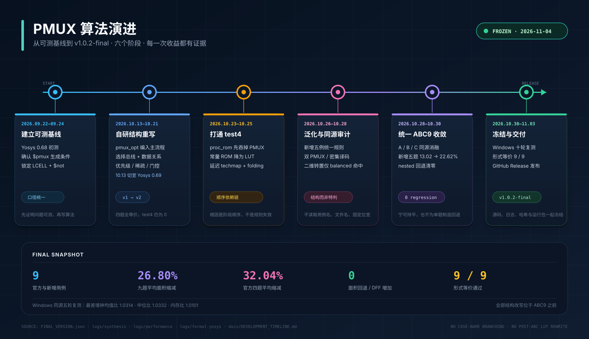

# PMUX 算法演进时间线

> 面向官方审阅的入口页。先看本页的阶段与设计取舍，再按文末“证据索引”下钻到源码、日志、消融、性能和形式验证。

## 一分钟结论

- 项目目标不是单独修好四个样例，而是在 Yosys `synth_intel -family cycloneiv` 流程中形成一套可复现、可形式验证的 PMUX 结构优化方法。
- 最终冻结版本覆盖 9 个用例：官方四题平均缩减 **32.04%**，新增五题平均 **22.62%**，九题平均 **26.80%**。
- 九题面积均不高于基线，DFF 均未增加；形式等价 **9/9** 通过。
- Windows 同源五轮复测的最差墙钟均值比 **1.0314**、中位比 **1.0332**、内存比 **1.0101**，均低于相对原版 `1.05` 的门槛。
- 最终提交使用同一套结构规则和同一个 ABC9 脚本，不存在按用例名、文件名、节点数或固定位宽分支的路径。

## 审阅说明

最终复现仓于 2026-11-04 从 v1.0.2 冻结交付包建立，随后把原始开发仓的真实提交
对象接入 `main`，使公开 Git 图能够从 2026-09-22 连续显示到最终交付。
提交日期、SHA 和说明均未回填或改写，最终代码树仍是冻结交付版。逐条索引
见 [`../DEVELOPMENT_LOG.md`](../DEVELOPMENT_LOG.md)。本页依据真实工作
日志、消融实验、综合日志和形式验证记录整理阶段时间线；早期探索数据只用
于说明设计决策，最终成绩只采用冻结包中的口径。

更细颗粒度的逐日研发记录和历史实验保留在团队的原始开发仓，其中也保留了
后来被撤回的旧结果。公开审阅所需的阶段结论、源码改动、综合日志、消融
数据、性能采样和形式验证均在本仓库中；评分与复现请以 `README.md`、
`FINAL_VERSION.json` 和 GitHub Release `v1.0.2-final` 为准。

**版本口径连续可追。** 2026-09-23 按组委会当时要求使用 Yosys 0.68 重测基线；10 月 13—14 日切换到 Yosys 0.69 并全量重测；最终 v1.0.2 交付统一锁定官网源码提交 `d0e71cfb…`。之后所有正式对照都要求同一源码树、同一构建参数和同一个 ABC。最终冻结包的实际构建身份、二进制和 ABC 哈希以 `FINAL_VERSION.json` 为准，不把不同阶段的数字拼成一条成绩。

## 时间轴总览

| 阶段 | 时间 | 主要问题 | 关键动作 | 阶段出口 |
|---|---|---|---|---|
| 01 建立可测基线 | 2026-09-22 — 09-24 | 赛题如何变成可验证的工程指标 | 按当期要求建立 Yosys 0.68 基线、`$pmux` 成因实验、统一面积口径 | 确认默认流程留有结构优化空间 |
| 02 自研结构重写 | 2026-10-13 — 10-21 | 不能依赖上游一步 `pmuxtree` | 切至 Yosys 0.69 重测；`pmux_opt` 进入 `synth_intel`；恢复选择总线与数据关系 | 官方四题形式等价，test4 仍为 0% |
| 03 打通 test4 | 2026-10-23 — 10-25 | `proc_rom` 提前吞掉常量 PMUX | 常量 ROM 降 LUT、延迟 techmap、LUT folding | 找到顺序依赖链，而非继续加局部特判 |
| 04 泛化与同源审计 | 2026-10-26 — 10-28 | 新增五题结构差异大，ABC 口径不一致 | 双 PMUX 共享、密集译码、稀疏更新、因子化、二维转置 | 规则由结构触发，矩阵转置只对 `balanced` 命中 |
| 05 统一 ABC9 收敛 | 2026-10-28 — 10-30 | 自定义映射是否带来局部回退 | A/B/C 同源消融，九题统一一个 ABC9 脚本 | 新增五题 `13.02% → 22.62%`，`nested` 回退清零 |
| 06 冻结与交付 | 2026-10-30 — 11-04 | 如何证明结果可复现、可交付 | Windows 同源五轮复测、整设计等价 9/9、源码与哈希冻结 | Release `v1.0.2-final` |

## 01｜先把问题变成可测的工程问题

**2026-09-22 — 09-24**

项目开始时先做三件事：确认组委会当时要求的 Yosys 0.68，复现官方基线，统一“面积”到底怎么数。早期实验确认 `case (sel)` 的常量并行比较会形成 `$pmux`，而三目链或独立 `if` 链通常是 `$mux` 树；两者语义不同，不能混为一谈。

这一阶段还发现了一个容易误读的现象：在一个微基准上，额外调用上游现成的 `pmuxtree` 可以把门级单元从 `132` 降到 `103`，约 `22%`。这个数字后来被明确标注为“诊断信号”，不是本项目算法成绩。它只说明默认流程确实留下了空间，不能作为最终成果。

**阶段决策**

- 不把上游一步 `pmuxtree` 当作作品创新。
- 自研 Pass，并把优化对象限定为可识别的 PMUX 结构及其消费者。
- 面积统一按 `cycloneiv_lcell_comb + $not` 统计，同时检查 DFF 不增加。
- 后续任何结构改写都必须通过形式等价，不能只凭单元数下降判断成功。

## 02｜从现象验证转入自研结构重写

**2026-10-13 — 10-21**

10 月 13—14 日先切换到 Yosys 0.69，保留 0.68 以便回退，并对基线、面积、等价性和规模化用例做全量重测；此后新数据不再混用 0.68 口径。随后 `pmux_opt` 的第一版进入 Yosys 主程序，不再依赖外部脚本拼接。算法从 RTLIL 网表恢复两类关系：同一选择总线驱动的多组数据选择，以及选择结果如何被后续寄存器或运算消费。

v1 主要解决双 PMUX 的共享选择；v2 扩展到优先级 `$mux` 链、稀疏部分更新、被寄存器使能门控的比较器、相邻选择码共因子化等结构。四条官方用例保持形式等价，但 `test4` 仍然完全没有收益。

这个“0%”没有被解释成算法无效，而是成为下一阶段的定位任务：如果结构识别正确，为什么 `test4` 里看不到可用于重写的 PMUX？

**阶段决策**

- 所有规则先检查位宽、选择互斥性、数据叶完整性和扇出边界，不满足就跳过。
- 用固定综合命令与形式等价作为准入门槛，避免“面积下降但语义改变”。
- 不为了追求平均分而放宽到无法证明的局部改写。

## 03｜定位 test4：问题在流程顺序，不在规则本身

**2026-10-23 — 10-25**

`test4` 的根因是 Yosys 的 `proc` 阶段先执行 `proc_rom`，把常量 `case` 转成常量 ROM；等 `pmux_opt` 进入时，网络中已经没有可供识别的 `$pmux`。继续添加 MUX 规则不会命中，必须改变“何时看到什么结构”。

最终修复形成一条有顺序依赖的链路：

1. 将可证明的常量 ROM 还原为 LUT 树，并标记为延迟 LUT。
2. 延迟通用 techmap，避免目标结构过早被拆散。
3. 在 ABC9 前做 LUT folding，吸收单输入 NOT、常量数据 MUX 和可由 DFF 同步控制实现的寄存器关系。
4. 所有结构改写仍位于 ABC9 之前；ABC9 后不修改 `$lut` 网表。

消融证明这三步不能把边际收益直接相加：关闭 ROM lowering 后，`test4` 回到基线；恢复官方提前 techmap 后，反而比基线更差。真正被修复的是结构生命周期，而不是某一条孤立规则。

最终冻结口径下，`test4` 为 `38 → 26`，缩减 `31.58%`，DFF 保持 `10 → 10`。

## 04｜把单例经验提升为结构规则

**2026-10-26 — 10-28**

新增五个用例覆盖 balanced、pipeline、crossbar、feedback、nested 等不同拓扑。项目没有为每个文件写分支，而是把可复用的结构特征抽象成规则：

- 双 PMUX 共享：多个选择器消费同一组操作数时，先合并选择再做一次运算。
- 密集译码改写：从选择编码直接构造受控 MUX 树，避免重复比较器。
- 稀疏选择表：缺码与默认分支 X 语义分开处理，相同子树折叠。
- 同运算符因子化：`mux(s, a0 op b0, a1 op b1, …)` 改为先选操作数、再做一次运算。
- 深链安全门槛：只有分支互不依赖时才重写嵌套 PMUX；发现串联依赖就保持原样。
- 有界固定点：每轮只做可证明的结构变化，九题均在第 2 轮达到 `changes=0`。
- 二维矩阵转置：改变“先选行再做运算”的顺序，先选择各列操作数，再执行共享运算。

二维矩阵转置是可复现的真实增益，但边界必须说清楚：九个用例中只有 `balanced` 触发该规则，其他用例的收益来自双 PMUX 共享、密集译码、稀疏更新、比较器和常量 ROM 等路径。矩阵转置不是全部成果的唯一来源。

这一阶段也完成了 ABC 同源审计。此前使用外部 ABC 或独立重编译 ABC 的结果不再混入最终口径；后续每个对照都要求同一 Yosys 源码、同一构建参数、同一份 ABC 可执行文件。

## 05｜统一 ABC9，消除局部回退

**2026-10-28 — 10-30**

最终算法将结构改写与目标映射联合考虑，但保持严格合规：九题只用一条 `techlibs/intel/cycloneiv/pmux_abc9.abc`，不在 ABC9 后重构 `$lut`，不按用例或节点数切换脚本。

三组同源消融说明了为什么必须采用统一 ABC9：

| 配置 | 官方四题平均 | 新增五题平均 | 九题平均 | `nested` | 面积回退 |
|---|---:|---:|---:|---:|---:|
| A：官方基线 | — | — | — | 413 | — |
| B：最终结构改写 + 默认 ABC9 | 31.10% | 13.02% | 21.05% | 416（回退） | 1 |
| C：最终结构改写 + 统一 `pmux_abc9.abc` | 32.04% | 22.62% | 26.80% | 344 | 0 |

B 组证明：结构重写本身已能改善官方四题，但新增五题仍受默认映射限制，并出现 `nested` 回退。C 组把新增五题从 `13.02%` 提升到 `22.62%`，九题从 `21.05%` 提升到 `26.80%`；官方四题同步提高，同时消除回退。

**收敛原则**

- 宁可持平，也不为了让单题好看而引入其他用例的回退。
- 先保证 DFF 不增加、形式等价通过，再讨论面积。
- ABC9 前后边界固定；不使用关闭 `abc9.verify`、修改 `io.cc`、ABC 后 `$lut` 重写等旧高分捷径。

## 06｜验证、冻结与公开交付

**2026-10-30 — 2026-11-04**

冻结前完成了三类独立检查：

1. **面积与目标原语**：18 份基线与候选综合日志，统一 `stat` 口径；九题 DFF 不变，最终网表无未映射宽 `$lut`。
2. **形式等价**：在 ABC9 之后、`map_cells` 之前对九个用例执行整设计 Yosys 等价，结果为 **9/9 PASS**；正式结论以 `logs/formal-yosys/result.json` 为准。
3. **效率**：Windows 同源五轮复测最差墙钟均值比 `1.0314`、中位比 `1.0332`、内存比 `1.0101`；测试时在墙钟区间内不轮询内存，并保证两臂使用同一个 ABC。

2026-11-04 冻结 v1.0.2 源码、二进制、日志、哈希和 `FINAL_VERSION.json`，同日发布 GitHub Release `v1.0.2-final`。

## 最终结果

| 口径 | 平均面积缩减 | 面积回退 | DFF 增加 | 形式等价 |
|---|---:|---:|---:|---:|
| 官方四题 | **32.04%** | 0 | 0 | 4 / 4 |
| 新增五题 | **22.62%** | 0 | 0 | 5 / 5 |
| 九题合计 | **26.80%** | 0 | 0 | 9 / 9 |

完整逐题结果见 [README 的结果表](../README.md#结果)。

## 关键纠错与设计取舍

| 现象 | 真实原因 | 处理方式 | 对最终成果的影响 |
|---|---|---|---|
| 早期微基准出现“一步 22%” | 来自上游 `pmuxtree`，不是自研算法 | 只作诊断，不纳入成绩 | 避免把现成 Pass 当作创新 |
| `test4` 长期为 0% | `proc_rom` 先于 `pmux_opt` 改变网络形态 | ROM lowering + 延迟 techmap + LUT folding | `test4` 最终 `38 → 26` |
| 不同阶段数字对不上 | 外部 ABC 与 vendored ABC 混用 | 同源 Yosys + 同一 ABC 双臂复测 | 撤回旧口径，冻结数据自洽 |
| 矩阵转置看似可“通杀” | 只有 `balanced` 满足完整二维矩阵条件 | 加结构边界，不扩大成用例分支 | 保留真实收益，不虚构泛化 |
| 新增五题映射收益不足 | 默认 ABC9 未针对改写后的结构 | 九题统一一条 ABC9 脚本 | 新增五题 `13.02 → 22.62%` |

## 泛化边界

- 规则按 RTLIL 结构触发，不读取用例编号、文件名、模块名、固定位宽或固定节点数。
- 九题平均达到满分线，不等于任意隐藏设计都必然获得同样收益；无法识别或不满足安全条件的结构会保持原样。
- 二维矩阵转置只覆盖满足行列覆盖与互斥选择条件的规则矩阵；其他形状走通用结构规则。
- 最终效率仍需以组委会评测环境复测为准；本仓库提供的是 Windows 同源审计和原始日志。

## 证据索引

| 审阅内容 | 位置 |
|---|---|
| 冻结版本、二进制与 ABC 哈希 | [FINAL_VERSION.json](../FINAL_VERSION.json) |
| 算法识别、重写、ABC 与形式验证说明 | [ALGORITHM_AND_METHOD.md](ALGORITHM_AND_METHOD.md) |
| 统一源码补丁 | [source/patches/changes.patch](../source/patches/changes.patch) |
| 九题逐例面积统计 | [logs/synthesis/stats.csv](../logs/synthesis/stats.csv) |
| 18 份基线与候选综合原始日志 | [logs/synthesis/](../logs/synthesis/) |
| 性能原始采样与汇总 | [logs/performance/](../logs/performance/) |
| 整设计等价结果 | [logs/formal-yosys/result.json](../logs/formal-yosys/result.json) |
| 最终测试说明 | [TEST_REPORT.md](TEST_REPORT.md) |
| 冻结 Windows 运行包 | [GitHub Release v1.0.2-final](https://github.com/nishuangran-png/PMUX-2026-Final/releases/tag/v1.0.2-final) |
| 开发日志与逐条提交索引 | [DEVELOPMENT_LOG.md](../DEVELOPMENT_LOG.md) |
| 原始开发工作仓 | [Gitee 提交历史](https://gitee.com/andy-n/fpga2026fpga2026) |

## 给审阅者的最短路径

1. 本页看阶段、纠错和 A/B/C 消融。
2. [README 的结果表](../README.md#结果) 核对九题最终面积与 DFF。
3. [changes.patch](../source/patches/changes.patch) 查看最终源码改动范围。
4. [stats.csv](../logs/synthesis/stats.csv) 与原始日志核对每个数字。
5. [形式等价结果](../logs/formal-yosys/result.json) 核对九题整设计等价结论。
